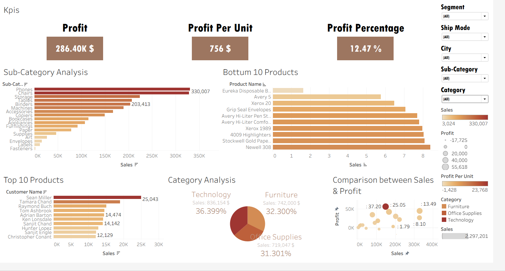

# Superstore Sales & Profit Performance Dashboard

An end-to-end data analytics and database design project. It covers relational database schema design normalized up to 5NF using SQL to eliminate data redundancy and ensure integrity, connected to an interactive executive dashboard in Tableau to monitor key performance indicators (KPIs) and drive strategic business decisions.

---

## 📊 Executive Dashboard



### 📌 Dashboard Breakdown & Key Insights:

1. **High-Level KPIs:**
   * **Total Profit:** **$286.40K**, reflecting the overall profitability of the store.
   * **Profit Per Unit:** **$756**.
   * **Profit Margin:** Achieved an overall profit margin of **12.47%**.

2. **Category Performance:**
   * **Technology:** Leads total revenue with **$836,154** (**36.399%** of total sales).
   * **Furniture:** Second largest contributor at **$742,000** (**32.300%**).
   * **Office Supplies:** Generates **$719,047** (**31.301%**).

3. **Sub-Category Analysis:**
   * Detailed revenue breakdown across all product lines, with **Phones** taking the top position at over **$330,007**, followed by **Chairs**, **Storage**, **Tables**, and **Binders**.

4. **Customers & Low-Performing Products:**
   * **Top Customers by Sales:** Led by **Sean Miller** (**$25,043**), followed by **Tamara Chand** and **Raymond Buch**.
   * **Bottom 10 Products:** Identifies lowest-performing items (e.g., Eureka Disposable, Avery 5, Xerox 20) to inform inventory optimization and product discontinuation decisions.

5. **Sales vs. Profit Correlation:**
   * A scatter plot highlighting profitability relative to sales volume across categories, pinpointing which segments yield the highest return.

6. **Interactive Filters:**
   * Dynamic filtering across **Segment**, **Ship Mode**, **City**, and **Category / Sub-Category** for targeted drill-down analysis.

---

## 🗄️ Database Architecture (ERD)

The database follows a **Star Schema** designed via database normalization to structure dimension and fact entities efficiently:

```mermaid
erDiagram
    Fact_Sales {
        int Row_ID PK
        int Order_ID 
        int Customer_ID FK
        int Product_ID FK
        int Location_ID FK
        int Ship_Mode_ID FK
        int Order_Date_ID FK
        int Ship_Date_ID FK
        float Sales
        float Profit
        int Quantity
        float Discount
    }
    
    Dim_Customer {
        int Customer_ID PK
        string Customer_Name
        string Segment
    }
    
    Dim_Product {
        int Product_ID PK
        string Product_Name
        string Category
        string Sub_Category
    }
    
    Dim_Location {
        int Location_ID PK
        string Region
        string City
        string State
    }
    
    Dim_Date {
        int Date_ID PK
        date Full_Date
        int Year
        int Quarter
        string Month_Name
    }
    
    Dim_ShipMode {
        int Ship_Mode_ID PK
        string Ship_Mode
    }

    Dim_Customer ||--o{ Fact_Sales : "1 to Many"
    Dim_Product ||--o{ Fact_Sales : "1 to Many"
    Dim_Location ||--o{ Fact_Sales : "1 to Many"
    Dim_ShipMode ||--o{ Fact_Sales : "1 to Many"
    Dim_Date ||--o{ Fact_Sales : "Order Date"
    Dim_Date ||--o{ Fact_Sales : "Ship Date"
